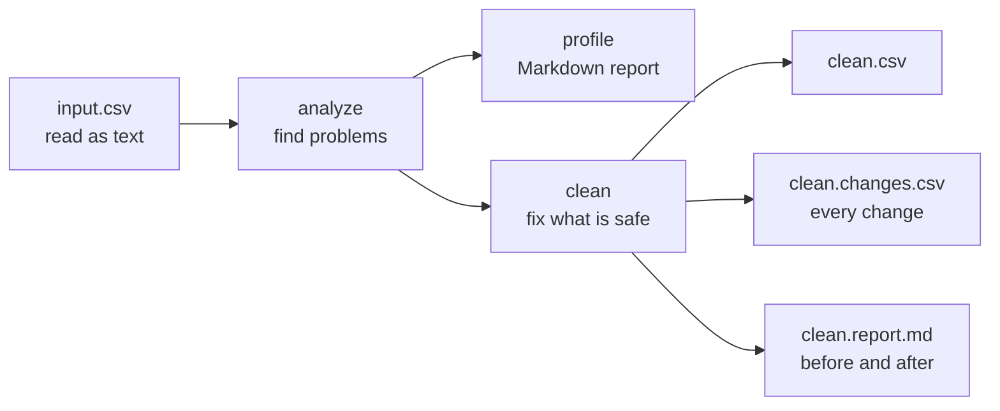

# csv-doctor

A command line tool that finds problems in a messy CSV file, writes a Markdown report, and saves a cleaned copy.

Most quick cleaning scripts change data and say nothing about it. I wanted one that logs every change, flags outliers instead of deleting them, and never touches the original file. It has no AI in it and makes no network calls.

This is the top of the real report from `csv-doctor clean examples/messy_orders_synthetic.csv -o out/clean.csv` (the sample is synthetic, more on that below):

```
## Before and after

| Issue | Before | After |
|---|---|---|
| missing values | 6 | 10 |
| duplicate rows (exact) | 1 | 0 |
| duplicate rows (near) | 1 | 0 |
| extra whitespace cells | 3 | 0 |
| inconsistent casing cells | 14 | 0 |
| mixed-type values | 2 | 0 |
| bad dates | 3 | 0 |
| outliers (flagged only) | 5 | 4 |
```

25 rows in, 23 rows out, 37 changes in the log. Missing values go up because bad dates and non-numbers are emptied, not guessed. The full report is further down.

## Quick start

Needs Python 3.10 or newer.

```
git clone https://github.com/YazanAlshareef/csv-doctor
cd csv-doctor
pip install -e ".[dev]"
csv-doctor profile examples/messy_orders_synthetic.csv
csv-doctor clean examples/messy_orders_synthetic.csv -o out/clean.csv
```

Run `pytest` to check the install. `csv-doctor --version` prints the version.

## How it works



`profile` stops after the report and changes nothing. `clean` writes three files next to the `-o` path. The log and report names come from the output name without `.csv`, so `v1.2.csv` gives `v1.2.changes.csv`, and an output called `result` gives `result.changes.csv`. Without `-o` the output is `<name>.clean.csv` next to the input. The tool refuses to run if any output path is the input file.

Row numbers in reports and logs are data rows, starting at 1, without the header.

## What it checks

| Check | How it is found | What `clean` does |
|---|---|---|
| Missing values | empty, `NA`, `N/A`, `null`, `none`, `nan`, `-`, `?` (any case) | writes an empty cell |
| Extra whitespace | spaces at the ends or doubled inside | trims, collapses to one space |
| Inconsistent casing | `Sydney`, `sydney`, `SYDNEY` in one text column | uses the most common spelling |
| Mixed types | a non-number in a number column, a number in a text column | number column: empties the cell. Text column: flags only |
| Bad dates | values in a date column that are not real dates (`2024-02-30`, `not a date`) | empties the cell |
| Mixed date formats | `16/01/2024`, `Jan 20 2024`, `2024-01-22` | rewrites to `YYYY-MM-DD` |
| Duplicates | exact repeats, and repeats that differ only by case, spaces or null spelling | keeps the first row, drops the rest |
| Outliers | numbers outside 1.5 x IQR, with at least 8 numbers in the column. Skipped for ID-like columns (name has `id`, leading zeros, or unique evenly spaced integers) | flags only, never changes |
| Spreadsheet formulas | text cells starting with `=`, `+`, `-` or `@` (plain numbers like `-5` do not count) | adds a leading `'` so Excel shows text. `--no-safe` turns it off |

A date column is one where half the values look like dates. If the column name has the whole word `date` (`order_date`, `startDate`, but not `candidate`), 30% is enough.

Ambiguous dates such as `03/04/2024` are read day first. Pass `--monthfirst` to change that. Dates that start with a year are always year-month-day.

If the file has blank or repeated headers, pandas renames them (`a`, `a.1`, `Unnamed: 2`). The tool prints a warning for each one.

## The full clean report

The before and after table is left out here because it is at the top.

```markdown
# CSV clean report: messy_orders_synthetic.csv

- Input (not modified): `messy_orders_synthetic.csv`, 25 rows
- Cleaned output: `clean.csv`, 23 rows
- Change log: `clean.changes.csv`, 37 changes
- Ambiguous dates like 03/04/2024 read as day first

## Changes by step

| Step | Changes |
|---|---|
| fix_case | 14 |
| fix_date | 9 |
| missing_value | 4 |
| trim_whitespace | 3 |
| bad_date | 3 |
| bad_number | 2 |
| drop_duplicate | 2 |

Outliers are flagged, not changed. Mixed-type values in a text column are flagged, not changed.

## What is still flagged in the cleaned file

- `amount` outliers outside 7.5 to 175.7 (1.5 x IQR): row 4: `210.00`, row 10: `99999.00`
- `quantity` outliers outside -0.5 to 3.5 (1.5 x IQR): row 7: `4`, row 13: `5`
```

Each change is one line in the log, for example `7,order_date,bad_date,2024-02-30,`.

The sample file `examples/messy_orders_synthetic.csv` is **synthetic**. I wrote it by hand and planted the problems on purpose. It holds no real people or orders.

Outliers stay in the cleaned file. Whether `99999.00` is a typo or a real big order is a call for a person.

## What broke

- Dates like `2024-02-05` came out as `2024-05-02`. I passed day-first to pandas for every date, and pandas swapped month and day on year-first values. The first sample run showed it. Year-first dates now skip the flag, and a test covers it.
- My first duplicate test failed because it used one column, so the rows really were duplicates. The test data was wrong, not the code.
- I found that a column called `candidate` with a few date-like values was treated as a date column, and the other cells were blanked. The name check now matches whole words.
- The change log kept the old value of formula cells as-is, so opening the log in Excel would run them. The log is now escaped too.

## Limits

- Everything is read as text. Currencies are not guessed: `$1,200` counts as text.
- A real value of `none`, `-` or `?` is treated as missing.
- Ambiguous dates need the `--dayfirst/--monthfirst` choice, because the tool cannot know which one your file uses.
- Mixed types in a text column are flagged, not fixed.
- Case fixing picks the most common spelling. On a tie it prefers mixed case.
- The whole file is loaded into memory.
- Escaped formula cells change the cell value (a leading `'`). It is logged as `escape_formula`.
- I tested it on the synthetic sample and small test frames only, never on real files. There are 16 tests.
- The CI workflow tests Python 3.10 and 3.12. I only ran it locally on 3.12, and I have not seen the Actions run yet.
- I did not run a separate lint step.

## Web demo

A small Gradio page wraps the same profile and clean code. It is not deployed anywhere yet.

```
pip install -r requirements.txt
python app.py
```

Open the local address it prints. Upload a CSV or press "Load sample CSV" to see the profile report, a cleaned preview, the change log, and downloads for the cleaned file and the log.

- Limits: 5 MB and 100,000 rows. Other files are rejected with a message.
- Nothing is stored: the upload is read in memory and the downloads go in a temporary folder.
- Only `.csv` files in UTF-8 are accepted. The cleaning is the same as `csv-doctor clean`.

## Files

See [WALKTHROUGH.md](WALKTHROUGH.md) for what each file does.

## Diagrams

- [Components and data classes](docs/diagrams/components.md)
- [Command sequences](docs/diagrams/sequences.md)
- [Column logic](docs/diagrams/column-logic.md)

## License

MIT
