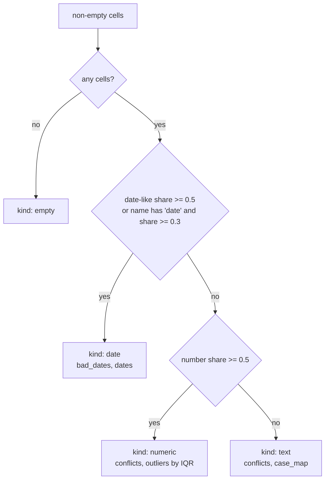
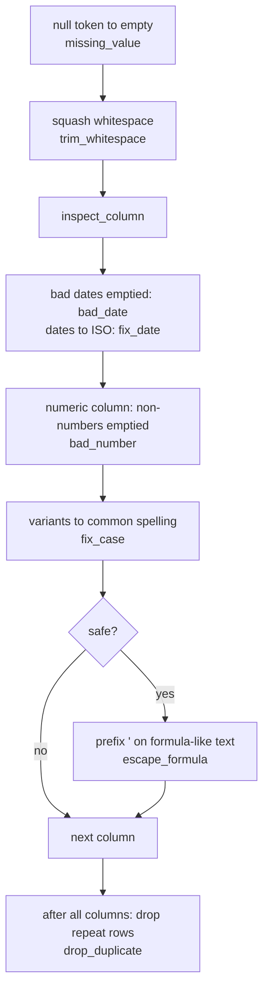

# Column logic

## How a column is classified

How `inspect_column` picks a column kind and what it flags. Empty cells are skipped. Shares are over non-empty cells.

## What clean does to each column

Steps `clean` applies per column, in order, then to whole rows. Each change goes to the log.

Outliers are flagged only and never changed.

Sources: [analyze.py](../../src/csv_doctor/analyze.py), [clean.py](../../src/csv_doctor/clean.py).
