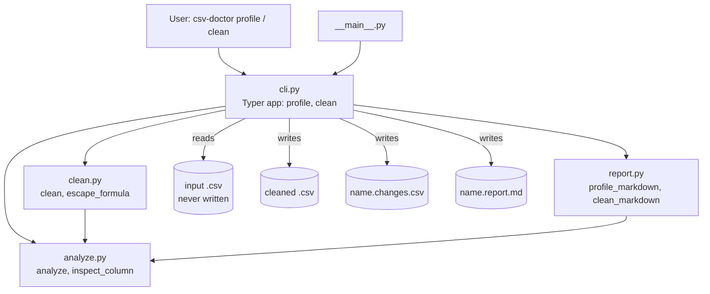
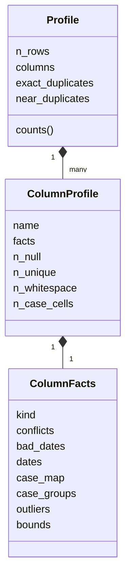

# Components

Modules in `src/csv_doctor` and what each one imports.

Sources: [cli.py](../../src/csv_doctor/cli.py), [analyze.py](../../src/csv_doctor/analyze.py), [clean.py](../../src/csv_doctor/clean.py), [report.py](../../src/csv_doctor/report.py), [__main__.py](../../src/csv_doctor/__main__.py).

# Data classes

The dataclasses that `analyze` returns and `report` reads.

Source: [analyze.py](../../src/csv_doctor/analyze.py).
