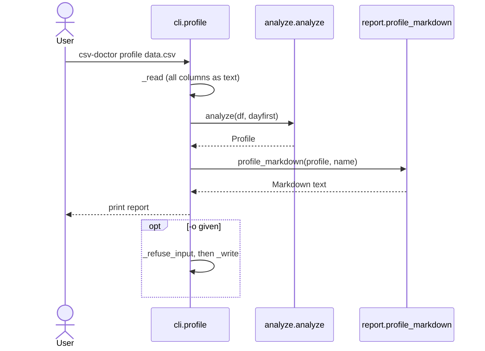
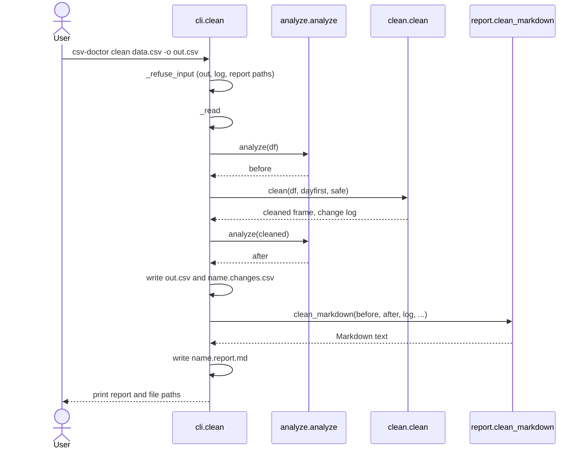

# Sequences

## profile command

The `profile` command reads, analyzes and prints. It writes a file only when `-o` is given.

## clean command

The `clean` command analyzes before and after cleaning, then writes three files.

Sources: [cli.py](../../src/csv_doctor/cli.py), [analyze.py](../../src/csv_doctor/analyze.py), [clean.py](../../src/csv_doctor/clean.py), [report.py](../../src/csv_doctor/report.py).
